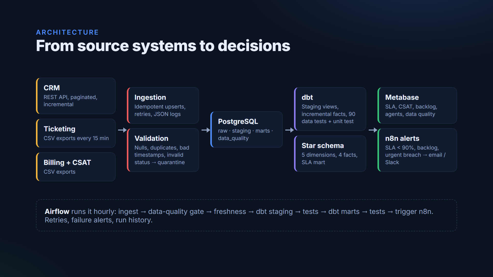
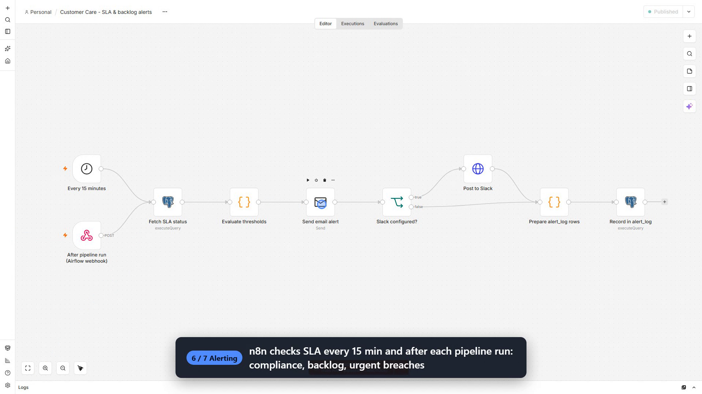
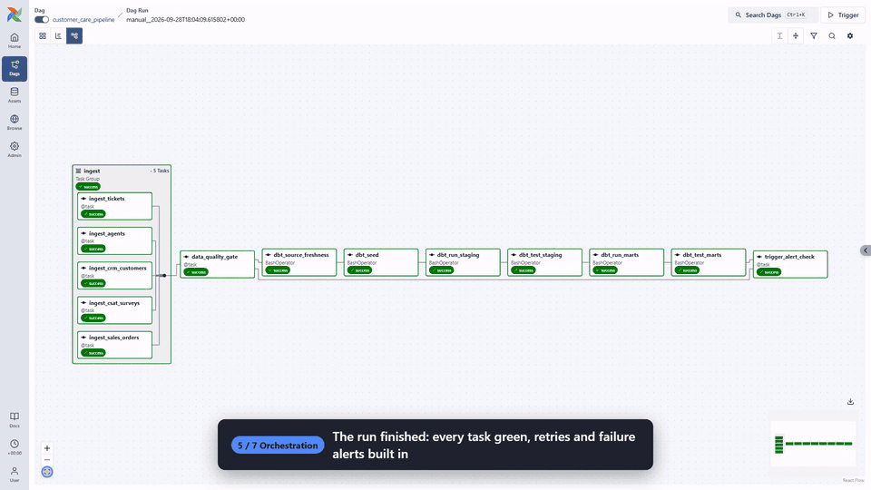

# Customer Care Data & SLA Intelligence Platform

An end-to-end data platform that turns CRM, ticketing, billing and CSAT data into SLA dashboards and real-time alerts for Customer Care management.
Everything runs locally with one command: `docker compose up`.


**Demo video (3 min, 1080p):** [docs/demo/media/customer-care-demo.mp4](docs/demo/media/customer-care-demo.mp4)
The video is recorded from the live stack: it triggers a real pipeline run, follows it through Airflow, and ends with the alert email n8n sends.

---

## The business problem

A Customer Care manager needs to answer, every day:

- Are we meeting our response-time SLAs, and for which priorities, channels and teams are we failing?
- Is the backlog growing faster than the team can resolve it?
- Are customers satisfied, and are tickets being closed properly or reopened?
- Which agents are overloaded, and who needs coaching?
- When an urgent ticket breaches its SLA, who finds out, and how fast?

The data to answer this lives in separate systems (CRM, ticketing, billing, survey tool), arrives with quality problems, and is only useful if it is fresh.
This project builds the pipeline, the model and the alerting that make those answers reliable.

## What it does

| Stage | What happens |
|---|---|
| **Sources** | A simulated CRM REST API plus ticketing, billing and CSAT systems dropping incremental CSV exports every 15 minutes. |
| **Ingestion** | Python validates every row (nulls, duplicates, invalid timestamps, invalid status, out-of-range scores) and quarantines bad rows with a reason. Loads are idempotent upserts. |
| **Warehouse** | PostgreSQL with separate `raw`, `staging`, `marts`, `data_quality` and `alerting` schemas and least-privilege roles per service. |
| **Transformation** | dbt builds a star schema (5 dimensions, 4 facts, daily SLA mart) with incremental facts and 90 data tests plus an SLA unit test. |
| **Orchestration** | Airflow runs hourly: ingest, data-quality gate, freshness check, dbt staging, tests, dbt marts, tests, alert check. Retries and failure alerts included. |
| **Dashboards** | Metabase dashboards for SLA operations and data quality, with date, category, channel, priority and agent filters. |
| **Alerting** | n8n emails (and optionally posts to Slack) when SLA compliance drops below 90%, the backlog exceeds its limit, an urgent ticket breaches SLA, or the pipeline fails. |



Full design notes: [architecture.md](architecture.md).
Dashboard definitions and metric formulas: [docs/dashboard_spec.md](docs/dashboard_spec.md).

## Screenshots

| Pipeline run in Airflow | Data quality monitoring |
|---|---|
|  |  |

| n8n alert workflow | Alert email |
|---|---|
|  |  |

## Engineering highlights

- **Realistic synthetic data.** A deterministic simulator models a B2B SaaS support team: weekday and business-hour peaks, Monday spikes, periodic outages, enterprise customers raising more urgent tickets, response times that depend on priority, channel, agent skill and load, reopens, and CSAT scores that drop after SLA breaches.
  Tickets progress through their lifecycle over time, so every run looks like a live system to the pipeline.
- **Defects on purpose.** About 1-2% of source rows carry the defects real exports have: null keys, duplicate deliveries, resolved-before-created timestamps, unparseable dates, unknown status values, negative amounts.
  Every one is caught and quarantined; nothing bad reaches the warehouse.
- **Idempotent, incremental loads.** File loads are atomic per file (data, quarantine rows and manifest commit together).
  Upserts skip unchanged rows, so replays are true no-ops.
  The CRM API is pulled incrementally with a watermark and an overlap window, and retried with backoff on 429/5xx.
- **Correct SLA logic.** A ticket with no reply yet counts as breached the moment its due time passes, not only after someone answers.
  Pending SLA outcomes are re-evaluated on every run, and a live view lets alerts see breaches between dbt runs.
- **Data-quality gate that does not cry wolf.** The pipeline stops on systemic problems (a broken export or schema change), but a single bad row in a small batch does not block the dashboards.
- **Actionable alerts.** Alert emails name the ticket, customer, category, agent and the numbers behind the breach.
  Dedup and cooldown stop the same alert from repeating.
  Pipeline failure alerts name the exact dbt test that failed.
- **Everything as code.** Metabase dashboards, n8n workflows and credentials, database roles and the SLA policy are all provisioned from the repo.

## Tech stack

| Area | Tools |
|---|---|
| Language | Python 3.12, SQL |
| Warehouse | PostgreSQL 17 |
| Transformation and tests | dbt-core 1.12, dbt-postgres 1.11 |
| Orchestration | Apache Airflow 3.3 (LocalExecutor) |
| BI | Metabase 0.63 (the marts also work with Power BI, see the dashboard spec) |
| Alerting | n8n 2.40, Mailpit as a local email inbox, optional Slack webhook |
| Infrastructure | Docker Compose |

## Data model

```
                      dim_date
                         |
 dim_customer ---- fact_tickets ---- dim_agent
                    |    |    \
       dim_channel -+    |     +- dim_ticket_category
                         |
     fact_sla (1 per ticket)   fact_csat (1 per survey)   dim_priority (SLA targets)

 fact_agent_performance: agent x day      mart_daily_sla_summary: one row per day
```

SLA targets per priority live in a dbt seed, so they are versioned and testable:

| Priority | First response | Resolution |
|---|---|---|
| Urgent | 15 min | 4 h |
| High | 1 h | 24 h |
| Medium | 4 h | 72 h |
| Low | 8 h | 120 h |

## Quick start

Requirements: Docker Desktop (or Docker Engine with Compose v2) and about 4 GB of free memory.

```bash
cp .env.example .env
docker compose up -d --build
```

The first start takes a few minutes.
The source systems export a 6-month backfill, Airflow runs the pipeline, and Metabase is provisioned automatically once the marts exist.

| Service | URL | Login |
|---|---|---|
| Metabase dashboards | http://localhost:3000 | `admin@example.com` / `Metabase-dev-1` |
| Airflow | http://localhost:8088 | `admin` / `admin` |
| n8n | http://localhost:5680 | `admin@example.com` / `N8n-demo-pw1` |
| Mailpit (alert inbox) | http://localhost:8025 | none |
| Mock CRM API | http://localhost:8001/health | header `X-API-Key` from `.env` |
| PostgreSQL | `localhost:5433`, database `customer_care` | `bi_reader` / `bi_dev_pw` (read-only) |

Login-free, read-only dashboard links are printed at the end of provisioning:

```bash
docker compose logs metabase-bootstrap
```

All ports and credentials are set in `.env`.
The values in `.env.example` are for local use only.

## Project structure

```
|-- architecture.md            design decisions and data flow
|-- docker-compose.yml         the whole platform
|-- data_generator/            source system simulator, CRM API, CSV exporter
|-- ingestion/                 validation + idempotent loading into raw.*
|-- sql/                       database roles, schemas, raw and data_quality tables
|-- dbt/customer_care/         staging, marts, SLA seed, tests
|-- airflow/                   image + DAG
|-- n8n/                       alert workflows, credentials rendering, auto owner setup
|-- metabase/                  dashboards as code + provisioning script
`-- docs/                      dashboard spec, demo video, slides and recorder
```

## Operations

**Run the pipeline now** instead of waiting for the hourly schedule: open Airflow, pick `customer_care_pipeline`, click Trigger.

**Change alert thresholds** in `.env` (`SLA_COMPLIANCE_THRESHOLD`, `BACKLOG_THRESHOLD`, `ALERT_COOLDOWN_MINUTES`), then run `docker compose up -d n8n`.

**Send alerts to Slack** by setting `SLACK_WEBHOOK_URL` in `.env` to an incoming-webhook URL.

**Re-deliver one source system** (for example after a correction in the source):

```bash
docker compose run --rm -u 50000:0 source-exporter python generate_data.py --landing-dir /data/landing --full --sources agents
```

**Rebuild the incremental facts** after deleting or correcting rows in `raw` (merges never propagate deletes):

```bash
docker compose exec airflow-scheduler bash -c 'cd $DBT_PROJECT_DIR && $DBT_BIN run --full-refresh --select fact_tickets+'
```

**Rebuild the dashboards from code:** `docker compose run --rm -e MB_FORCE_RECREATE=true metabase-bootstrap`.

## Data quality

| Layer | Checks |
|---|---|
| Ingestion | Required fields, timestamp parsing and ordering, future timestamps, enums (status, priority, channel, segment), numeric ranges, status/resolution consistency, in-file duplicates. Rejects go to `data_quality.rejected_records` with a reason. |
| Pipeline gate | Fails the run when more than 5% of a batch (100+ rows) is rejected, or when a small batch is mostly garbage. |
| dbt sources | Uniqueness, not-null and freshness per source (thresholds match how often each system changes). |
| dbt models | Uniqueness, not-null, accepted values, relationships from every fact to every dimension, non-negative durations, percentages in range. |
| dbt business tests | Every ticket has an SLA row, ticket timelines are ordered, open status matches resolution, no future tickets, the daily summary reconciles with the facts, unknown customers stay under 1%. |
| dbt unit test | SLA met / breached / pending logic, including unanswered tickets past their due time. |

## Demo video

The video in `docs/demo/media/` is recorded from the running stack with Playwright.
To record it again:

```bash
pip install playwright && playwright install chromium
SLA_COMPLIANCE_THRESHOLD=95 docker compose up -d n8n   # stricter demo target so an alert fires on camera
python docs/demo/record_demo.py --out docs/demo/raw
docker compose up -d n8n                               # back to the 90% target
```

## Troubleshooting

**A port is already in use.** Change the matching `*_HOST_PORT` value in `.env` and run `docker compose up -d` again.

**HTTP 431 "Request Header Fields Too Large".** Browsers send every `localhost` cookie from every local app to every port.
Metabase and n8n are configured to accept large headers; if another tool complains, clear the cookies for `localhost` or use `http://127.0.0.1:<port>`.

**Dashboards are empty.** The marts are built by the first Airflow run.
Check the run in Airflow, then `docker compose logs metabase-bootstrap`.
# customer-care
